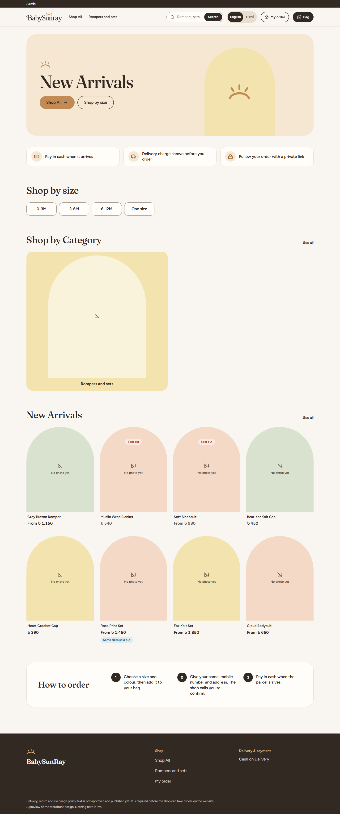
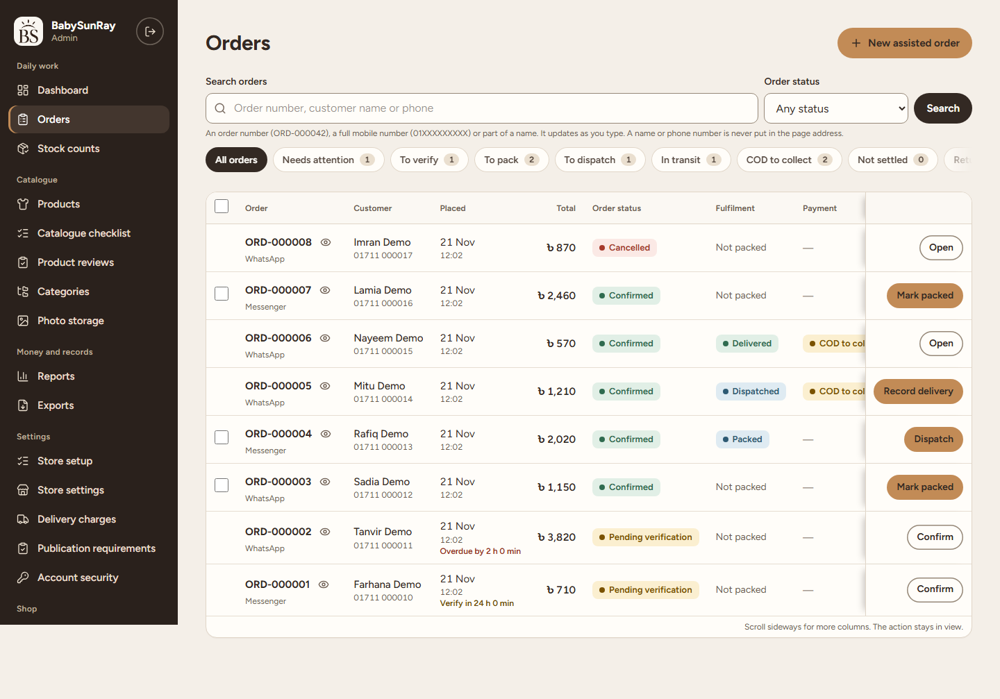

<div align="center">

# BabySunRay

**A bilingual online shop and back office for a baby and kidswear business in Bangladesh.**

English · বাংলা · Cash on delivery · Built for phones first

</div>



---

## About

BabySunRay is a complete online shop for a small clothing business. Shoppers browse in English or বাংলা, check the size chart, and order with cash on delivery, with no account needed. The owner runs everything from a single Admin: products, stock, orders, cash-on-delivery money, returns, printed slips and reports.

It was built for how small shops in Bangladesh actually work: orders arrive from the website, Messenger and WhatsApp; every order is confirmed by phone; and cash moves from customer to courier to shop in separate steps that all need tracking.

## Preview

| Product page | Owner dashboard |
|---|---|
|  |  |

| Orders | Reports |
|---|---|
|  |  |

<sub>Screenshots use made-up test data.</sub>

## Features

### For shoppers

- **Two languages:** every page, button and message works in English and বাংলা.
- **Clear sizing:** sizes, colours and a size chart in centimetres on every product.
- **Cash on delivery:** the delivery charge is shown before ordering, and no card or account is needed.
- **Optional account:** sign up with email or Google to see past orders.
- **Order tracking:** a private link for each order, with self-cancel while it's still waiting for the shop's call.

### For the shop owner

- **Orders in one place:** search by order number, name or phone, and take the next step in one tap. Pack or dispatch many orders at once.
- **Quick view:** see the customer, items and payment without leaving the list.
- **Products:** bilingual content, photos, variants, size charts, a readiness checklist and spreadsheet import.
- **Honest stock:** items are held when an order arrives and leave stock only when the parcel is sent. Physical stock counts are built in.
- **Cash on delivery tracking:** collected, settled and courier fees are recorded separately, with a reconciliation check.
- **Returns:** returned items wait for inspection before they can be sold again.
- **Reports and records:** period reports, Excel/CSV exports, and A4 picking lists and shipping slips.

## How an order flows

```
 Order placed ──► Confirmed ──► Packed ──► Dispatched ──► Delivered ──► Closed
 (stock held)    (phone call)              (stock leaves)  (owner's record)
                                                │
                                   COD: collected ──► settled to the shop
```

Late orders (past 24 hours) can still be confirmed: stock is checked again first, so nothing is ever sold twice.

## Built with

| | |
|---|---|
| **Application** | Next.js, React, TypeScript |
| **Data** | PostgreSQL, Drizzle ORM |
| **Sign-in** | Better Auth (email, password and Google) |
| **Design** | Tailwind CSS, with a custom design system called "First Light" |
| **Email and images** | Resend, Cloudinary |
| **Testing** | Vitest, Playwright, axe-core |

One application with no separate backend. The website and the `/api/v1` API share the same business rules, so future mobile apps can use them too.

## Getting started

```bash
npm install
cp .env.example .env.local     # add your database and sign-in settings
npm run db:migrate
npm run dev                    # open http://localhost:3000/admin
```

Full setup, configuration and testing: **[developer docs](docs/README.md)**.

## Documentation

| | |
|---|---|
| [User guide](docs/user-guide.md) | How to run the shop day to day, in plain words |
| [Developer docs](docs/README.md) | Setup, architecture, API and operations |

## Status

Built and running on a protected test site, with the public launch still to come. Online card payments and automatic courier links are planned for later.

---

<div align="center">

Built by **Redwanul Rashik** · [rkrashik@gmail.com](mailto:rkrashik@gmail.com)

</div>
