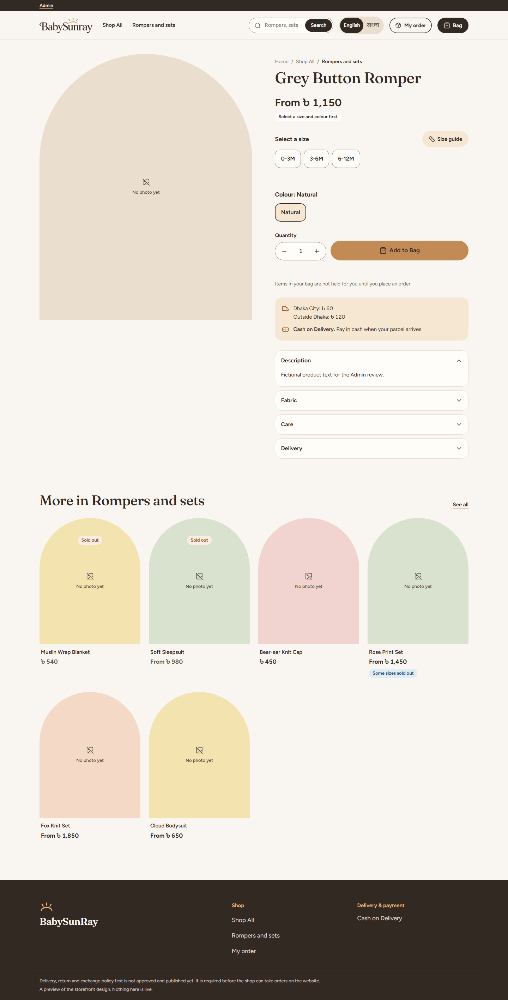
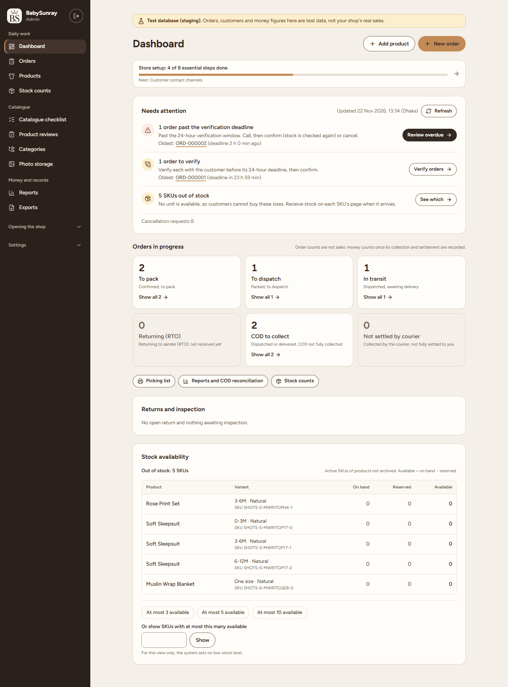
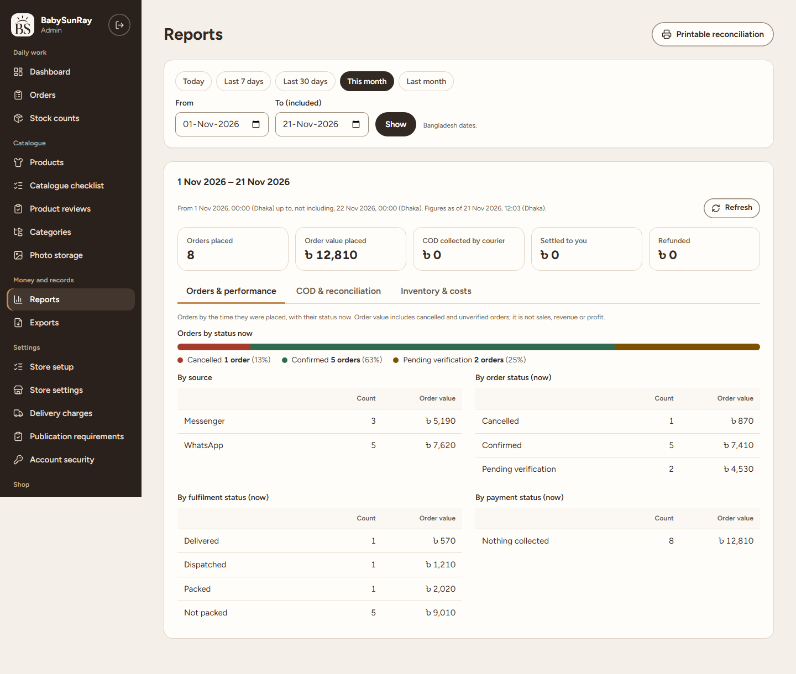

<div align="center">

# BabySunray

**A bilingual online shop and back office for a baby and kidswear business in Bangladesh.**

English · বাংলা · Cash on delivery · Built for phones first

</div>


---

## About

BabySunray is an online shop and back office for a small clothing business. Shoppers browse in English or বাংলা, check the size chart, and order with cash on delivery, with no account needed. The owner runs everything from one Admin: products, stock, orders, cash-on-delivery money, returns, printed slips and reports.

It was built for how small shops in Bangladesh actually work: orders arrive from the website, Messenger and WhatsApp; every order is confirmed by phone before it is packed; and cash moves from customer to courier to shop in separate steps that each need recording.

> **Not open to the public yet.** The shop runs on a private test site that only the owner's team can open. Public checkout stays switched off until the owner approves the store's policies and the launch.

## Preview

| Product page | Owner dashboard |
|---|---|
|  |  |

| Orders | Reports |
|---|---|
|  |  |

<sub>Screenshots come from the automated browser tests and use made-up products and customers. The products have no photos, so the shop shows its "No photo yet" state, and the shop pictures keep the owner preview's "Preview only, not live" line.</sub>

## Features

### For shoppers

- **Two languages:** every page, button and message works in English and বাংলা.
- **Clear sizing:** sizes, colours and a size chart in centimetres (or inches) on every product; the button always says what to choose next, and sold-out choices say so.
- **Find things fast:** search, filters and sorting by newest or price.
- **Cash on delivery:** the delivery charge is shown before ordering (the area chosen in the bag carries into checkout), and no card or account is needed.
- **Or pay in advance:** by bKash, Nagad or bank transfer when the owner turns them on: the shop's details and the exact amount after ordering, then the transaction ID on the private order page. It counts only once the owner has checked the money arrived.
- **Optional account:** sign up with email or Google to see past orders.
- **Order tracking:** a private link for each order, with self-cancel while it's still waiting for the shop's call.
- **Easy to reach the shop:** the footer lists only the contact channels the owner has set: phone, email, WhatsApp, Messenger, Facebook and Instagram.

### For the shop owner

- **Orders in one place:** search by order number, name or phone, and take the next step in one tap. Pack or dispatch many orders at once.
- **Quick view:** see the customer, items and payment without leaving the list.
- **Staff with limited roles:** invite a manager or helpers for orders, products or stock by a one-time link; each sees only their own work, and the owner can change a role or switch someone off at once.
- **Advance payments checked by hand:** customers' transaction IDs wait in one list until the owner verifies or rejects them; refunds due on cancelled prepaid orders stay visible until recorded.
- **Products:** bilingual content, photos, variants, size charts, a readiness checklist and spreadsheet import.
- **Honest stock:** items are held when an order arrives and leave stock only when the parcel is sent. Physical stock counts are built in.
- **Cash on delivery tracking:** collected, settled and courier fees are recorded separately, with a reconciliation check.
- **Returns:** returned items wait for inspection before they can be sold again.
- **Reports and records:** period reports that keep order activity apart from money actually collected, Excel/CSV exports, and A4 picking lists and shipping slips.
- **Shop set-up:** store details, logo, contact and social links, delivery charges, bilingual policy drafts and a launch-readiness checklist, all without touching code.

## How an order flows

```
 Order placed ──► Confirmed ──► Packed ──► Dispatched ──► Delivered ──► Closed
 (stock held)    (phone call)              (stock leaves)  (owner's record)
                                                │
                                   COD: collected ──► settled to the shop
```

Late orders (past 24 hours) can still be confirmed: stock is checked again first, so nothing is ever sold twice.

## Built with

| | |
|---|---|
| **Application** | Next.js, React, TypeScript |
| **Data** | PostgreSQL, Drizzle ORM |
| **Sign-in** | Better Auth (email, password and Google) |
| **Design** | Tailwind CSS, with a custom design system called "First Light" |
| **Optional services** | Resend for account emails, Cloudinary for published photos (each off until configured) |
| **Hosting (staging)** | Netlify, private to the owner's team; PostgreSQL on Supabase |
| **Testing** | Vitest, Playwright, axe-core |

One application with no separate backend. The website and the `/api/v1` API share the same business rules, so future mobile apps can use them too.

## Getting started

```bash
npm install
cp .env.example .env.local     # add your database and sign-in settings
npm run db:migrate
npm run dev                    # open http://localhost:3000/admin
```

Full setup, configuration and testing: **[developer docs](docs/README.md)**.

## Documentation

| | |
|---|---|
| [User guide](docs/user-guide.md) | How to run the shop day to day, in plain words |
| [Developer docs](docs/README.md) | Setup, architecture, API and operations |

## Status

| | |
|---|---|
| **Built and tested** | The shop, guest checkout with cash on delivery or a manual advance payment, customer accounts, order tracking, staff roles, and the whole Admin, with unit, database and browser tests |
| **Running on staging** | A private Netlify site on a test database, where the owner rehearses real orders through "founder acceptance" |
| **Not public yet** | Public checkout is closed until the owner approves the delivery, return and privacy policies and the launch |
| **Not built** | Online card or mobile-wallet payment gateways, courier integrations, automatic messages to customers, and an AI shopping assistant |

---

<div align="center">

Built by **Redwanul Rashik** · [rkrashik@gmail.com](mailto:rkrashik@gmail.com)

</div>
