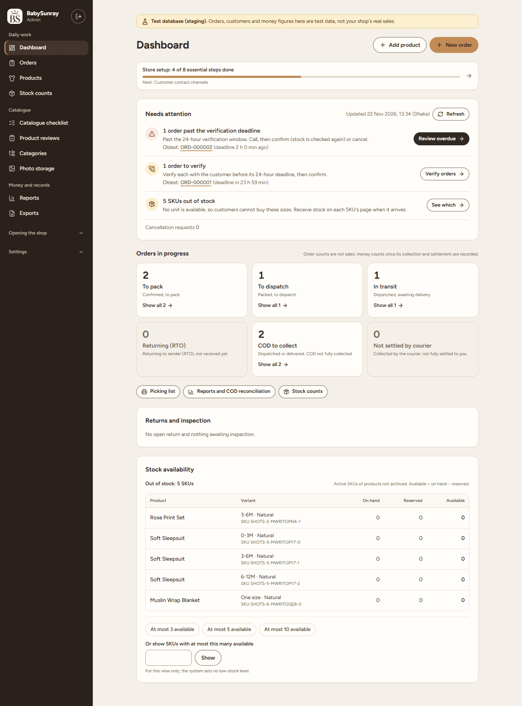
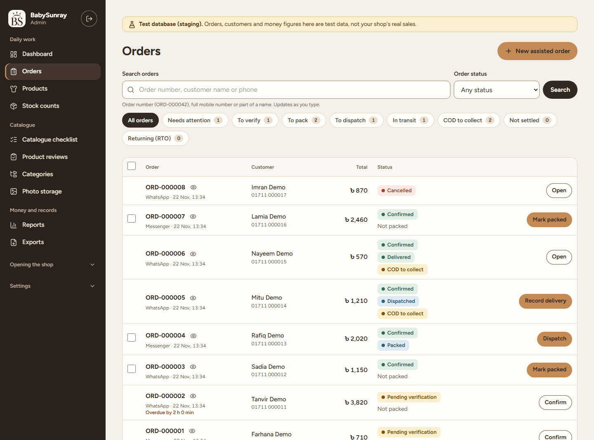
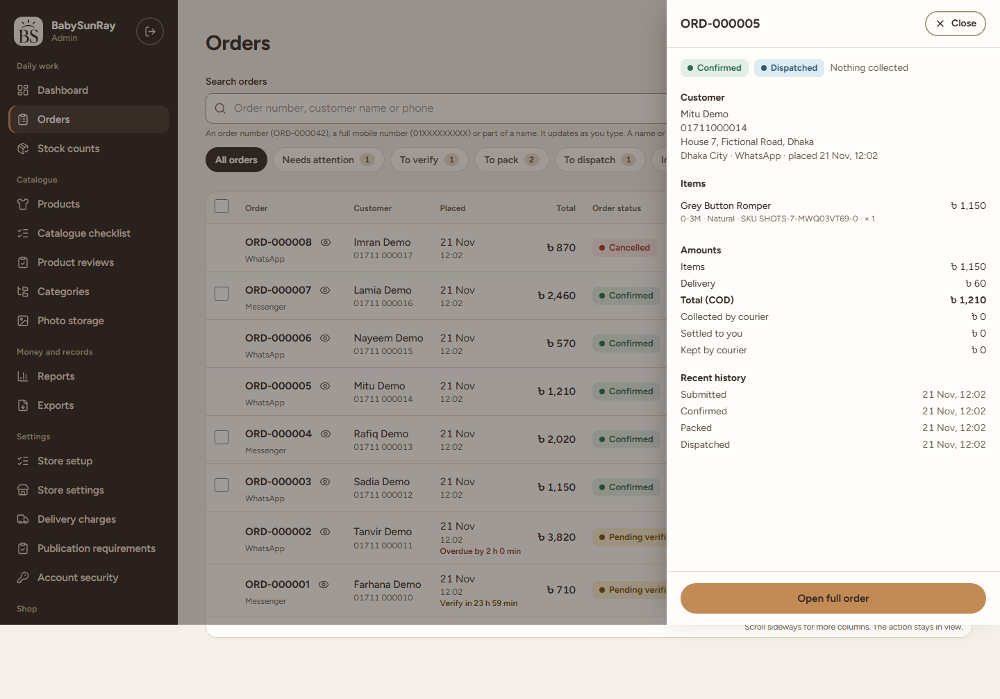
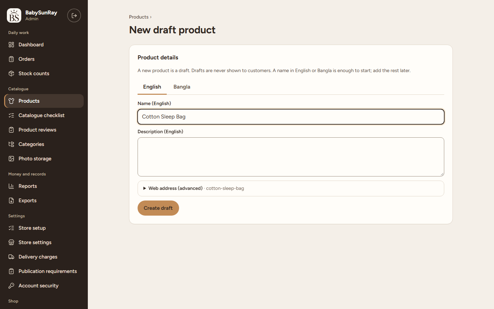
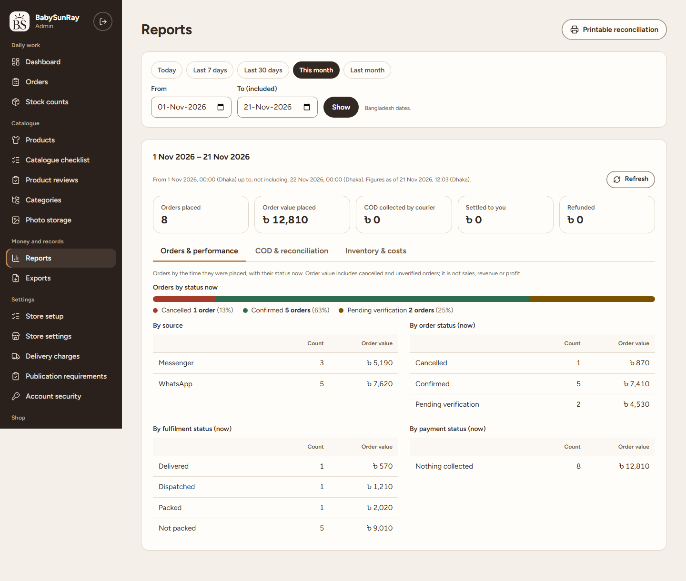

# BabySunRay Admin — User Guide

This guide shows you how to run the shop day to day: adding products, taking orders, sending parcels, keeping track of cash on delivery, and reading your reports.

You don't need any technical knowledge. If you can use Facebook or WhatsApp, you can use this.

---

## Contents

1. [Signing in](#1-signing-in)
2. [Finding your way around](#2-finding-your-way-around)
3. [Your daily routine](#3-your-daily-routine)
4. [Orders](#4-orders)
5. [Products](#5-products)
6. [Stock](#6-stock)
7. [Money and cash on delivery (COD)](#7-money-and-cash-on-delivery-cod)
8. [Returns and cancellations](#8-returns-and-cancellations)
9. [Reports and exports](#9-reports-and-exports)
10. [Shop settings](#10-shop-settings)
11. [What your customers see](#11-what-your-customers-see)
12. [Good habits and safety](#12-good-habits-and-safety)
13. [Quick help](#13-quick-help)

---

## 1. Signing in

1. Open your shop's address and add **/admin** at the end (for example `yourshop.com/admin`).
2. Type your email and password, then press **Sign in**.

**Forgot your password?** Use one of the **recovery codes** you saved when the account was created. Open **/admin/recover**, type your email and one code, and choose a new password. Each code works once.

> **Tip:** Keep your recovery codes somewhere safe and offline (a notebook, a locked drawer). You can make new ones in **Settings → Account security**.

When you finish, press **Sign out** (top of the menu). This also clears any customer search you made on this device.

---

## 2. Finding your way around

On a **computer**, the menu is on the left.
On a **phone**, the most used pages are at the bottom of the screen: **Dashboard**, **Orders**, **Products** and **Menu** (everything else).

| Menu group | What's inside |
|---|---|
| **Daily work** | Dashboard, Orders, Products, Stock counts |
| **Catalogue** | Catalogue checklist, Product reviews, Categories, Photo storage |
| **Money and records** | Reports, Exports |
| **Shop** | Storefront preview, Policies, Shop acceptance, Launch readiness |
| **Settings** | Store setup, Store settings, Delivery charges, Publication requirements, Account security |

On a computer, **Shop** and **Settings** are folded, because you use them less often. Click the group's name to open it. When you are on one of their pages, the group stays open. On a phone, **Menu** always lists every page.

**A yellow "Test database (staging)" bar** at the top of every page means this Admin is connected to the test database. Orders, customers and money figures there are test data, not your shop's real sales.

**After you save something**, a small green message appears at the bottom of the screen (for example *"Order packed."*). It means the change really was saved.

**If something goes wrong**, a red message explains what to do. Nothing you typed is lost — fix it and try again.

---

## 3. Your daily routine

Start every day on the **Dashboard**.



The dashboard shows what needs you, most urgent first:

```
┌──────────────────────────────────────────────┐
│  NEEDS ATTENTION                             │  ← each line says why, and has a button
│  • Orders past the verification deadline     │     that takes you there
│  • Cancellation requests                     │
│  • Orders to verify                          │
│  • SKUs out of stock                         │
├──────────────────────────────────────────────┤
│  ORDERS IN PROGRESS                          │  ← then pack, send and collect
│  To pack · To dispatch · In transit          │
│  Returning (RTO) · COD to collect ·          │
│  Not settled by courier                      │
└──────────────────────────────────────────────┘
```

Under **Needs attention**, each line tells you what happened, why it matters, the oldest orders, and has a button to the right list (for example **Verify orders**). If nothing is listed, nothing needs you right now. A delivery zone without a charge, and returned items waiting for inspection, also appear here.

**Orders in progress** shows how many orders are in each step of the day's work. Press **Show all** to open that list. These are order counts, not sales: money counts only once you record that it was collected and settled.

A simple daily rhythm:

1. **Call** customers in *Orders to verify* and confirm their orders.
2. **Pack** the orders in *To pack*.
3. **Dispatch** the packed parcels with the courier.
4. **Record** deliveries and COD money as the courier reports them.
5. Glance at **Stock availability** at the bottom — it lists items that have run out.

The buttons at the top (**Add product**, **New order**) and the shortcuts below the order counts (**Picking list**, **Reports and COD reconciliation**, **Stock counts**) take you straight to common work. Press **Refresh** at any time to see the latest numbers.

---

## 4. Orders



### How an order moves

```
New order ──► Confirmed ──► Packed ──► Dispatched ──► Delivered ──► Closed
 (verify by     (after you     (ready to     (with the       (your        (after the
  phone call)    call them)     send)         courier)        record)      return window)
```

### Finding an order

Use the **Search orders** box. You can type:

- an order number — `ORD-000042` or just `42`
- the customer's full mobile number — `01712 345678`, `+8801712345678` (Bangla digits work too)
- part of the customer's name

The list updates as you type. The chips under the search box (**To verify**, **To pack**, **To dispatch** …) show one group at a time, with a count on each.

> Customer names and phone numbers are never shown in the page address, so they don't end up in your browser history.

### Quick look without opening

Press the **eye icon** next to an order number. A panel opens on the right with the customer, the items, the amounts and the recent history. Press **Close** or **Esc** to go back to the list. To see everything, press **Open full order**.



### Taking the next step

Each row has one button for the next step:

| Button | When to press it |
|---|---|
| **Confirm** | After you have called the customer and they said yes |
| **Mark packed** | The parcel is packed and labelled |
| **Dispatch** | You handed it to the courier. **This takes the items out of stock** |
| **Record delivery** | You know the parcel arrived (the courier or the customer told you) |
| **Open** | Anything else — opens the full order |

Important questions are asked before anything happens. Press **Cancel** if you're not sure.

### Late orders (past 24 hours)

Every new order should be confirmed within **24 hours**. If it's late, you'll see **"Overdue by …"** in red.

You can **still confirm it**. The system checks the stock again first:

- If the items are still available, the order is confirmed as normal.
- If someone else bought them meanwhile, you'll get a clear message and nothing changes.

### Doing many at once

On a computer, tick the boxes on the left of several orders. A bar appears at the bottom:

- **Mark N packed** — for orders waiting to be packed
- **Dispatch N orders** — for packed orders

Each order is handled separately. If one can't be done (for example someone changed it in another window), you'll see exactly which one and why — the others still go through.

> Delivery is always recorded **one order at a time**, because it's your own record, not proof from the courier.

### Creating an order yourself

For orders that come through **Messenger, WhatsApp or a phone call**, press **New assisted order**. Fill in the customer's name, phone, address, delivery area, and the item codes (SKUs) with quantities. The stock is held for that customer straight away.

### Sending a tracking link

On the full order page you can create a **tracking link** for the customer. Copy it and send it on WhatsApp or Messenger. It's shown **only once** — copy it right away.

---

## 5. Products

### Adding a product



1. Go to **Products → Add product**.
2. Type the **name** first. There are two tabs:
   - **English** — name and description in English
   - **Bangla** — নাম ও বিবরণ বাংলায়
3. The **web address** of the product is made automatically from the name. You can change it under **Web address (advanced)**, but usually you don't need to.
4. Press **Create draft**.

A new product is a **draft** — customers can't see it yet.

### Finishing the product

On the product's page:

| Section | What to do |
|---|---|
| **Edit details** | Description, fabric, care instructions, size guidance, category — in both languages |
| **Size chart** | Measurements in centimetres for each size |
| **Photos** | Upload photos and describe each one in English and Bangla |
| **Add a variant** | Each size/colour is a *variant* with its own code (SKU) and price |

> **Fabric:** only write what you can prove (the care label or the supplier's paper). Avoid words like "organic" or "100% safe" without proof. Tick the confirmation box once it's correct.

### Is it ready?

The **Catalogue checklist** page shows, for all drafts, what's still missing (names, photos, measurements…). Click a number to see those products.

On the product list, each draft shows either **Information complete** or **N missing**.

### Publishing

1. Open the product and press **Mark the current content as reviewed**.
2. Then press **Publish to the shop**.

Publishing only works when everything your **Publication requirements** ask for is filled in. You can **Withdraw from the shop** a published product at any time — it becomes a draft again.

### Working with many products

On a computer, tick several draft products. You can then:

- **Apply category** to all of them, or
- **Archive** them (they stay in your records but can't be sold or edited)

### Importing from a spreadsheet

**Products → Import products** lets you add many new drafts from an Excel or CSV file. Download the template, fill it in, and press **Check file** first — it shows every problem before anything is saved.

---

## 6. Stock

Every variant has its own stock page (click its code, the SKU).

| Action | When |
|---|---|
| **Receive stock** | New goods arrived from the supplier |
| **Adjust stock** | Something was damaged, lost or miscounted (a reason is required) |

Words you'll see:

- **On hand** — what's physically in your room
- **Reserved** — held for orders not yet dispatched
- **For sale / Available** — on hand minus reserved

### Counting your stock

Once in a while, do a **Stock count** (menu: Daily work → Stock counts). Print the count sheet, count the items, type the numbers, review the differences, and apply. Every difference is saved with a reason.

---

## 7. Money and cash on delivery (COD)

COD money moves in steps, and each step is recorded separately:

```
Customer pays courier  ──►  Courier sends money to you
      "Collected"                  "Settled"
                                   (minus any courier charges: "Kept by courier")
```

On the full order page, use **Record amount** to add:

- **Collected** — the courier collected cash from the customer
- **Settled** — the courier paid that money to you
- **Deducted** — the courier kept part of it (their fee)

> **Delivered is not the same as paid.** An order can be delivered while the money is still with the courier. The **COD to collect** and **Not settled** chips on the Orders page show exactly these.

---

## 8. Returns and cancellations

**Cancellations**

- Before you confirm, the customer can cancel themselves from their tracking link.
- After you confirm, they can **ask** to cancel. You'll see it in **Cancellation requests** on the dashboard. Open the order and approve or reject.
- You can cancel an order yourself any time before it's dispatched. Held stock goes back for sale.

**Returns (within 7 days of delivery)**

1. Open the order → record the return request.
2. When the parcel comes back, mark it received. The items wait for **inspection** — they're not sold again yet.
3. Inspect each item: **Passed** puts it back in stock, **Failed** keeps it out.
4. Record any refund you paid (bKash, Nagad or bank transfer).

**Returned to sender (RTO)** — if the customer refused the parcel, use **Mark returned to sender**, then receive it and inspect it the same way.

---

## 9. Reports and exports



Go to **Reports**. Pick a quick range (**Today**, **Last 7 days**, **This month** …) or your own dates.

The report has three tabs:

| Tab | What it tells you |
|---|---|
| **Orders & performance** | How many orders, by source and status |
| **COD & reconciliation** | Money collected, settled and still with the courier, plus every order with COD still open |
| **Inventory & costs** | Stock received and sent, return and RTO costs |

> "Order value" is the total of orders placed — **not profit**. Cancelled and unverified orders are included.

If the reconciliation check ever turns red, the payment records don't match — don't rely on the COD numbers until it's fixed.

**Printing:** press **Printable reconciliation** for an A4 copy.

**Exports:** **Exports** gives you Excel, CSV or JSON files of orders, products or stock. Some exports contain customer details — keep those files private and delete them when done.

---

## 10. Shop settings

Do these once, from **Settings → Store setup** (it shows a checklist):

| Setting | Why |
|---|---|
| **Store settings** | Your shop's name, short description, contact numbers and logo |
| **Delivery charges** | The charge for Dhaka City and Outside Dhaka. Orders can't be taken without them |
| **Categories** | e.g. Rompers, Sets, Accessories |
| **Policies** | Your delivery, return and privacy policies, in English and Bangla |
| **Publication requirements** | What every product must have before customers can see it |
| **Account security** | Recovery codes |

> If the menu shows **"Your store — Set store name"**, your shop's name hasn't been entered yet. Click it to add it.

### Changing a setting safely

**Store settings** and **Delivery charges** show what is saved as plain text, so nothing changes by accident.

1. Press **Edit details** (or **Change charge** for a delivery zone).
2. Change what you need, then press **Save changes** (**Save charge**). A green message confirms it was saved, and the page shows the saved values again.
3. Changed your mind? Press **Cancel**. If you had typed something, you are asked first whether to discard it. Leaving the page with unsaved changes also asks first.

### Your logo

The **Logo** card shows the logo in use and where it comes from. To change it, press **Replace logo**, choose a file (PNG, JPEG or WebP, at most 5 MB; a PNG with a transparent background works best), check the preview, then press **Save logo**. **Cancel** keeps the current logo. If the file cannot be used, a red message says why and the logo in use does not change.

### Customer account emails

This card explains the two emails customers receive when they make an account with an email address: a **verification email** and a **password reset email**.

- **Email service: Set up** means the website has the settings it needs to send them. **Not set up** or **Settings incomplete** means no email can be sent; ask whoever set up your website (the details are under *For the person who sets up the website*).
- **Delivery: Not checked** — the Admin cannot see whether an email reached a customer. To check, make a customer account in the shop with an email address you own and see whether the verification email arrives (look in the spam folder too).

Customers never need an email account to order.

---

## 11. What your customers see

- They browse the shop in **English or Bangla**.
- They choose size and colour, add to bag, and order with **Cash on Delivery**. No account is needed, but they can make one (with email or Google) if they like.
- They get a **tracking link** to follow their order and, while it's still waiting for your call, to cancel it.

> Until you officially launch, the shop is closed to the public. You can see it safely through **Storefront preview** or **Shop acceptance**.

---

## 12. Good habits and safety

- **Never share your password** or recovery codes — not even with staff.
- **Sign out** on shared computers.
- **Don't use real customer data for practice.** Use made-up names and numbers.
- **Confirm by phone** before pressing *Confirm*. It protects you from fake orders.
- **Dispatch only what you've really handed over** — dispatching removes the items from stock.
- **Download exports only when needed**, and delete them afterwards.

---

## 13. Quick help

| Problem | What to do |
|---|---|
| "This order changed after you loaded it" | Someone (or you, in another tab) changed it. Reload the page and try again |
| "Not enough stock" | Receive more stock, or change the order |
| A product can't be published | Open it — the **Publication** section lists exactly what's missing |
| A search says "expired" | Searches are forgotten after 15 minutes for privacy. Just search again |
| Orders can't be taken for an area | Set its charge in **Delivery charges** |
| Forgot password | Use a recovery code at **/admin/recover** |
| The page looks out of date | Press **Refresh** (Dashboard, Reports) or reload the page |
